<div align="center">



# Windhawk Inspector

**Understand what a Windhawk mod can do before installing it.**

Analyze C++ source code in your browser, review sensitive capabilities, and compare mod versions without running the code.

**[Open Windhawk Inspector](https://windhawk-inspector.luizbizzio.com/)**

[](LICENSE)

</div>

Windhawk Inspector is a free, independent community tool for [Windhawk](https://windhawk.net/). It is **not affiliated with or endorsed by Windhawk**. It is also **not an antivirus, malware detector, or proof that a mod is safe**.

## Get started

1. Open the **[Inspector](https://windhawk-inspector.luizbizzio.com/)**.
2. Find a Windhawk mod by name or ID, enter a supported URL, upload a source file, or paste C++ code.
3. Select **Analyze source**.
4. Review **Worth a closer look** and **Other things found**. Open the source evidence to see why an item was reported.
5. If needed, compare two versions or download a JSON or HTML report.

Local files and pasted code are analyzed **in your browser**. They are not uploaded to an Inspector server. When you enter a URL, the browser fetches the public source directly from GitHub.

## Features

- **Mod search:** Find mods from a local copy of the official Windhawk catalog, updated during the daily website build.
- **Source analysis:** Find Windows APIs and other code patterns that may need review.
- **Clear results:** See important findings first, with explanations that do not require deep C++ knowledge.
- **Activity icons:** Color-coded symbols for network access, files, processes, input, permissions, camera and microphone APIs, and more. Colors identify activity types, not risk levels.
- **Code evidence:** View the matched API, source line, arguments, and nearby code. Switch between **Show nearby lines** and **Show full source** to navigate the whole file without slowing down large reports.
- **Version comparison:** Find changes in detected capabilities between versions of the same mod.
- **GitHub history:** Choose earlier versions from the official Windhawk mods repository when their commit messages include version numbers.
- **Technical details:** See parser coverage, possible limitations, process targets, and the full SHA-256 hash.
- **Report exports:** Download JSON for detailed data or a standalone HTML report for reading and sharing.
- **Private local processing:** Source analysis runs in browser Web Workers, without compiling or executing a mod.

### What does the Inspector look for?

| Area | Examples |
| --- | --- |
| Network and downloads | HTTP requests, sockets, remote data and download APIs |
| Files and Registry | Reading, writing, deleting, moving, and Registry access |
| Processes and memory | Starting processes and accessing another process's memory |
| Hooks and code loading | Windhawk hooks, Windows hooks, DLL loading and remote execution APIs |
| Permissions and persistence | Token operations, services and scheduled tasks |
| Input and sensitive data | Keyboard state, credential-related APIs and protected data |
| Camera and microphone | Specific Windows video-capture and audio-input APIs |
| Windhawk metadata | Declared process includes, excludes and broad process targeting |

The Inspector reports **code patterns**, not actions that definitely happened. A normal mod can use some of these APIs for valid reasons.

## Read the results

The main report separates findings into **Worth a closer look** and **Other things found**. Select a finding to review its explanation and source evidence. The technical section also shows information about the analysis.

| Result | Meaning |
| --- | --- |
| **Detected** | A matching API or declared capability was found in the source. |
| **Potential** | A source pattern was found, but its exact purpose or runtime behavior is not known. |
| **Not detected** | No matching pattern was found by the current rules. This does **not** mean the behavior is absent. |
| **C++ syntax parsed** | The Tree-sitter C++ parser was used. Some macros or syntax regions may still be hard to interpret. |
| **Mixed scan** | The detailed parser reached a limit, and a simpler scan helped cover the source. |
| **Basic text scan** | The detailed parser was not available or the source was too large for that mode. Results may be less accurate. |

Severity is a **review priority**, not a malware score. The source viewer can jump to reported lines, and the full list of occurrences is kept in exported reports.

## Compare mod versions

**Using the Windhawk catalog**

1. Select a mod from the catalog.
2. Enable **Compare versions**.
3. Choose an earlier version found in the [official Windhawk mods GitHub history](https://github.com/ramensoftware/windhawk-mods).
4. Open the linked commit to read its changes, then run the comparison.

**Using your own sources**

Choose **File, URL or code** to compare uploaded files, supported links, or pasted source code.

Both sources must declare the **same Windhawk `@id`**. Comparisons between different mods, or between identical sources, are blocked. The comparison shows added and removed *detected findings*, not a full code diff or a security verdict.

GitHub history depends on the public GitHub API. Some versions may not appear if a commit has no recognizable version number or the API is temporarily rate-limited. Manual comparison remains available.

## Supported sources

| Input | Example or format |
| --- | --- |
| Windhawk mod page | `https://windhawk.net/mods/taskbar-zones` |
| GitHub source file | `https://github.com/owner/repo/blob/main/mod.wh.cpp` |
| Raw GitHub source | `https://raw.githubusercontent.com/owner/repo/main/mod.wh.cpp` |
| Local file | `.wh.cpp`, `.cpp`, `.h`, `.hpp`, `.txt` |
| Pasted source | C++ code entered directly in the editor |

For security, URL loading accepts supported public Windhawk and GitHub sources, not arbitrary websites. GitHub browser links with branch names containing `/` may not work; use a suitable raw URL instead.

**Source limit:** 50 MB. Sources over 8 MB use a limited text scan instead of the full Tree-sitter C++ scan. Detailed inspection also has limits of 2 million syntax nodes and 60,000 call expressions. Large files can take longer, and some results may be missed.

## How it works

| Component | Purpose |
| --- | --- |
| React, TypeScript and Vite | Browser interface and static website |
| Tree-sitter C++ WebAssembly | Reads C++ syntax without compiling the source |
| Web Workers | Run analysis outside the main page interface |
| Detection rules | Match supported APIs and explain possible capabilities |
| GitHub API | Lists known older versions for comparison |
| Browser crypto API | Calculates the source SHA-256 hash |
| GitHub Pages and Actions | Host the site, run tests, and refresh the mod catalog |

The catalog is downloaded from the [official Windhawk catalog](https://mods.windhawk.net/catalogs/en.json) during deployment and a daily scheduled build. The count and update date shown on the website come from this generated file. They are not hard-coded.

The Inspector does not need a backend for analysis. Downloaded HTML reports can be opened without the website.

## Privacy and limitations

- Uploaded files and pasted source code stay in the browser during analysis. The Inspector does not send them to its own server.
- Public URL mode fetches source from GitHub. Version selection also makes requests to GitHub's API.
- The Inspector **does not execute, compile, or sandbox the mod**.
- It does not scan compiled binaries, follow every dependency, or prove what a mod does at runtime.
- C++ macros, indirect calls, dynamic code and parser recovery regions can lead to missed or incomplete findings.
- A normal code change may appear as a finding change, even when actual behavior is similar.
- **No findings does not mean a mod is safe.** Check the source and its dependencies before installing software you do not trust.

## Local development

You need **Node.js 22+** and npm. The GitHub workflows use npm 11 for compatibility with Vitest 4.

```bash
npm ci
npm run dev
```

Run the tests and production build:

```bash
npm test
npm run test:catalog
npm run build
```

Generate the catalog locally (requires internet access):

```bash
npm run catalog
```

The `postinstall` script copies the Tree-sitter WebAssembly files into `public/wasm/`. They are not stored in the Git repository.

## Deployment

The website is hosted at **https://windhawk-inspector.luizbizzio.com/** with GitHub Pages and GitHub Actions. The Pages workflow builds the site at `/` for the custom domain and generates a fresh mod catalog each day.

To use this domain with your own fork, update the custom domain in GitHub Pages and the DNS record. This project does not need a `CNAME` file because it deploys through GitHub Actions.

## Issues and feedback

Found a wrong result, missing API, or website problem? [Open an issue](https://github.com/luizbizzio/windhawk-inspector/issues). For detection problems, include a small C++ example and explain the expected result. **Do not post private source code or secrets in a public issue.**

For security issues, follow [SECURITY.md](SECURITY.md) and report sensitive details privately. Do not disclose vulnerabilities in public issues.

## Release and browser verification

The [GitHub Releases page](https://github.com/luizbizzio/windhawk-inspector/releases) has published versions and their changes. The [browser smoke test](https://github.com/luizbizzio/windhawk-inspector/actions/workflows/browser-smoke.yml) checks three real mod sources in Chromium, including uploads, pasted code, URLs, reports, source viewing and version history.

## License and attribution

Copyright © 2026 [Luiz Bizzio](https://github.com/luizbizzio). The project's original code is published under the **[Apache License 2.0](LICENSE)**.

The Windhawk name and logo belong to their respective owners. This project's license does not change the rights to third-party names, logos, or trademarks.

Windhawk Inspector is an unofficial community project. It is not sponsored, maintained, or endorsed by Windhawk.
